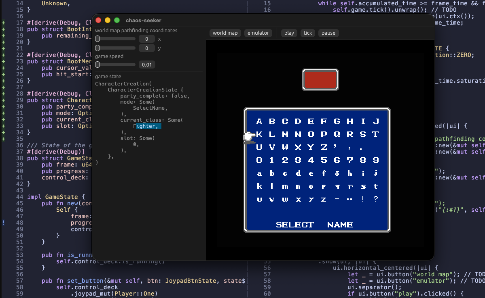
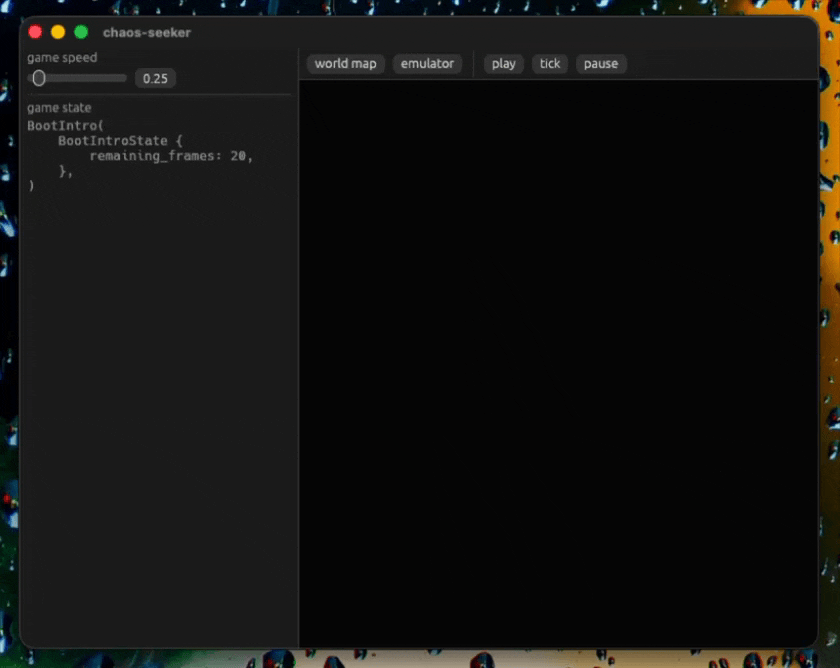

chaos-seeker
============
final fantasy 1 reverse-engineering project with [tetanes_core](https://docs.rs/tetanes-core/latest/tetanes_core/):
- [world map data](https://datacrystal.tcrf.net/wiki/Final_Fantasy/World_map_data#FF1_Overworld_Tile_Values) extracted with [RLE FSM](./chaos_seeker/src/overworld.rs),
- [A* pathfinding](./chaos_seeker/src/pathfinding.rs) implemented using [extracted world map data](./chaos_seeker/src/snapshots/chaos_seeker__overworld__parse_overworld_map.snap),
- egui [debugger](./debugger/src/main.rs) which plays the game with an [embedded emulator](./chaos_seeker/src/state.rs) by running [handlers](./chaos_seeker/src/engine.rs) which read NES memory

<a href="./debugger.png"></img></a>

---

<a href="./debugger.gif"></img></a>

---

<a href="./pathfinding.png"></img></a>

## blog posts
- [parsing the final fantasy 1 NES world map (part 1)](https://djan.org/blog/ff1-world-map)

## resources
- https://datacrystal.tcrf.net/wiki/Final_Fantasy
